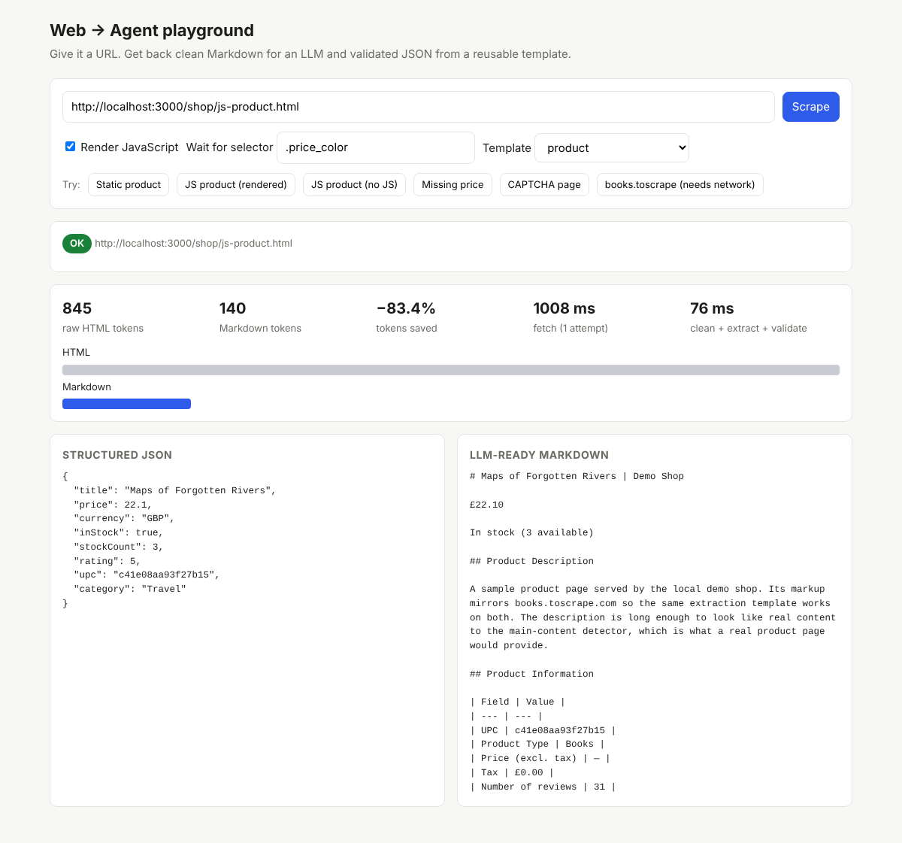
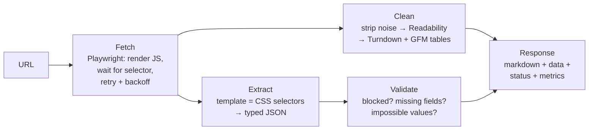

# Web → Agent pipeline (mini prototype)

A small working version of the core problem behind real-time web data APIs:
**turn a messy live web page into something an AI agent can use**, in two forms.

| Product | Input | Output |
| --- | --- | --- |
| **1. LLM-ready Markdown** | a URL | clean Markdown: no nav, scripts, cookie banners; tables kept; ~80% fewer tokens than raw HTML |
| **2. Structured extraction** | a URL + a template name | typed JSON (zod-validated) plus a status: `ok`, `partial`, `blocked` or `failed`, with reasons |



## Run it

```bash
pnpm install
pnpm demo            # builds, starts http://localhost:3000
```

- `http://localhost:3000/`: the playground UI (screenshot above)
- `http://localhost:3000/shop/`: a tiny fictional shop to scrape
- `http://localhost:3000/api/scrape?url=<url>&template=product&render=true&waitFor=.price_color`: the API

Chromium comes from Playwright. If it isn't installed on your machine, run `pnpm exec playwright install chromium` once.
npm works too: `npm install && npx playwright install chromium && npm run demo`.
If the Chromium download fails, use your installed Google Chrome instead: `BROWSER_CHANNEL=chrome npm run demo`.

## How it works



| Step | File | What it does |
| --- | --- | --- |
| Fetch | `src/fetch/fetcher.ts` | Headless Chromium. Optional JS rendering and `waitFor` selector. Retries timeouts and 5xx/429 with jittered exponential backoff; typed `FetchError`. |
| Clean | `src/clean/` | Removes nav/footer/scripts/cookie banners, makes links absolute, fixes header-less tables, picks main content (Readability, with a fallback when it grabs too little), converts to Markdown. |
| Extract | `src/extract/templates/product.ts` | One template per page type: CSS selectors → fields → zod schema. No LLM per page. |
| Validate | `src/validate/checks.ts` | CAPTCHA/bot-wall detection, required fields, schema checks (price > 0, rating 1–5). |
| Orchestrate | `src/pipeline/scrape.ts`, `server.ts` | One call: fetch → clean → extract → validate → one self-describing JSON answer. |

## Demo script (5 scenarios, all one click in the UI)

The demo shop copies books.toscrape.com's HTML structure, so the same `product` template
also works on the real site where the network allows it.

| Preset | What you see | The point |
| --- | --- | --- |
| Static product | `ok`, all 8 fields, 747 → 148 tokens (−80%) | The happy path: Markdown for agents, JSON for systems. |
| JS product (rendered) | `ok`, price £22.10 appears | The price is injected by JavaScript 600 ms after load; we wait for `.price_color`. |
| JS product (no JS) | `partial`: price, currency, inStock missing | What a plain HTTP scraper sees. **Without validation this would be a silent failure.** |
| Missing price | `partial`: missing required field `price` | The layout changed or the field was removed. The data is flagged instead of shipped as if it were fine. |
| CAPTCHA page | `blocked`: keyword "Verify you are human" | The page loaded, but it's a bot wall, not content. That calls for a different action: retry through another proxy. |

Numbers above are from the local demo shop (token counts use the `o200k_base` tokenizer as a
proxy; Claude's tokenizer gives different absolute numbers, the ratio is what matters).

## What I'd say about scaling to 10M pages/day

- **Queue + workers**: URLs into Kafka/SQS, stateless browser workers autoscaled; render only when a cheap HTTP fetch fails validation (rendering costs ~10× more).
- **Proxy layer**: `blocked` status feeds proxy/fingerprint rotation per domain.
- **Template drift monitoring**: track the `partial` rate per template per domain; a spike means the site changed its layout → regenerate the template (an LLM proposes new selectors once; extraction stays deterministic and cheap).
- **Caching**: by URL + freshness requirement; dedupe identical content by hash.
- **Cost**: Markdown cuts LLM input tokens ~80%; templates avoid an LLM call per page entirely.

## Questions I'd ask the team

- How do you decide per domain whether to render JS or use a plain fetch?
- How do you detect template drift today, and how fast do you fix it?
- What share of failures are blocks vs. layout changes vs. timeouts?
- Do customers want Markdown, JSON, or both, and how often do they need data fresher than a cache hit?
