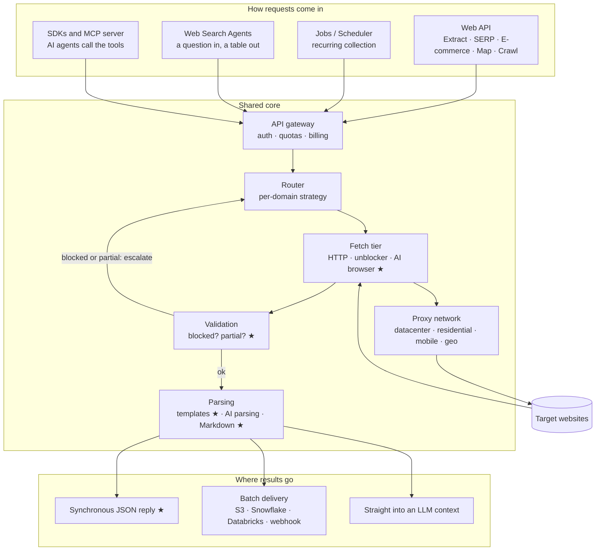
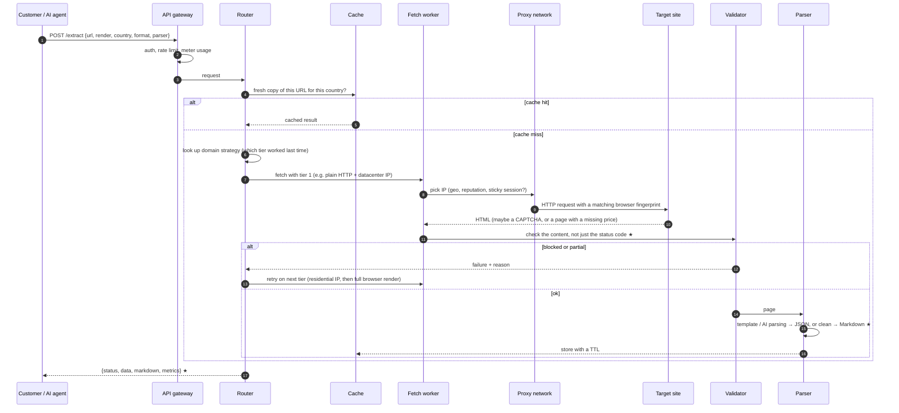
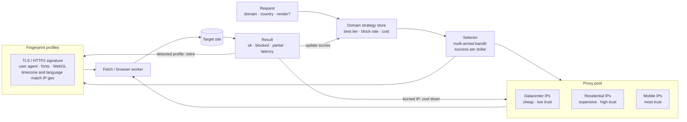
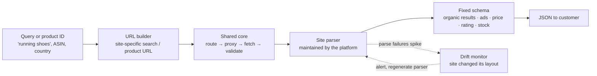
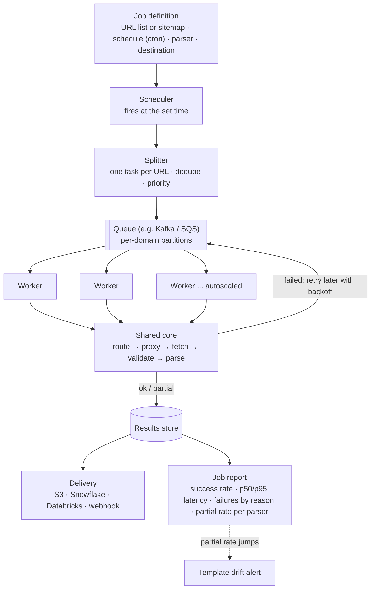
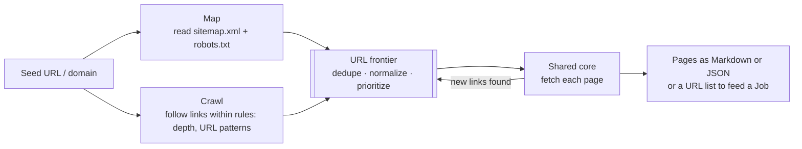
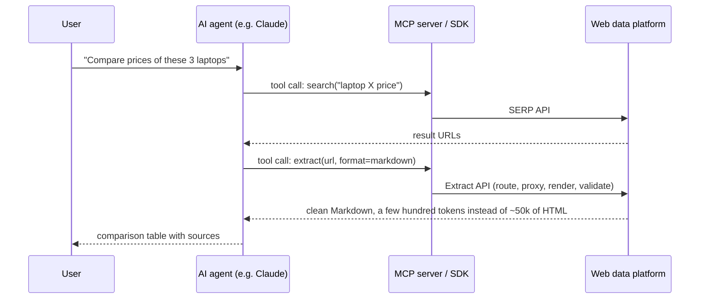

# How a web-data platform like Nimble moves data

These diagrams show how a platform like Nimble *plausibly* works, built from public product
descriptions (Web API, scraping infrastructure, Jobs, Web Search Agents, SDK/MCP). They are
**not** Nimble's internal architecture. Use them to reason and ask good questions, and check
the product names against nimbleway.com before the interview.

Each box marked ★ is something this repo's prototype does in miniature.

---

## 0. The whole platform on one page

Every product sits on the same core: **route → fetch through proxies → check → parse → deliver.**
The products differ in *how requests come in* and *where results go*.

---

## 1. Web API: one real-time request (Extract)

A customer sends one URL and waits a few seconds for the answer. The key idea is the
**escalation loop**: try the cheap way first and step up only when validation says it failed.

**Things to note:**
- The **router's per-domain memory** is what makes this cheap at scale: most domains settle on one tier.
- **Validation decides the retry**, not the HTTP status. A 200 OK CAPTCHA page must still count as a failure.
- Billing usually depends on the tier used (rendering and residential bandwidth cost the most).

---

## 2. Inside the routing and proxy layer

This is where most of the hard engineering lives: picking an IP and a browser profile that
look consistent, and learning from every result.

**The feedback loop is the product.** Every result updates three things: the domain's
strategy, the IP's reputation, and the fingerprint profile's health.

---

## 3. SERP and E-commerce APIs: specialized parsers

These are the same pipeline with a **maintained parser per site** (Google, Amazon, Walmart…)
and a fixed output schema. The customer asks for a query or product ID, not a URL.

The value to the customer: they never maintain selectors. The platform absorbs layout changes.

---

## 4. Jobs / Scheduler: recurring batch collection

For "every morning, scrape these 200,000 product pages and drop the results in Snowflake".
Here throughput and cost matter more than latency.

**Things to note:**
- **Per-domain partitions** let you enforce politeness (rate limits per site) and stop one slow site from blocking others.
- Failed tasks go **back on the queue** with growing delays instead of blocking the job.
- The job report is like the batch summary planned for this repo's Phase 3.

---

## 5. Map and Crawl: discovering URLs

Before you can scrape a site, you need its URLs.

---

## 6. Where LLMs fit (three different jobs)

LLMs are expensive per call, so the design question is always **"LLM once, or LLM every page?"**

```mermaid
flowchart TB
  subgraph A["A. LLM builds the parser once (cheap at scale)"]
    A1["New site: sample HTML, trimmed"] --> A2["LLM proposes CSS selectors<br/>for the target schema"]
    A2 --> A3["Template saved"]
    A3 --> A4["Deterministic extraction<br/>on millions of pages ★"]
    A4 -. "validation partial rate rises" .-> A1
  end

  subgraph B["B. LLM parses each page (flexible, costly)"]
    B1["Cleaned Markdown ★<br/>~80% fewer tokens than HTML"] --> B2["LLM extracts fields<br/>for a schema given at request time"]
    B2 --> B3["JSON + schema validation"]
  end

  subgraph C["C. Web Search Agents (LLM plans the research)"]
    C1["Question:<br/>'top 20 CRM tools with pricing'"] --> C2["Plan: queries and sources"]
    C2 --> C3["SERP API → candidate URLs"]
    C3 --> C4["Extract API → Markdown per page"]
    C4 --> C5["LLM reads, dedupes,<br/>fills a table schema"]
    C5 --> C6["Structured table<br/>with source URLs"]
  end
```

- **A** is the cost win: one LLM call per site layout, not per page. That's Phase 4 of this repo's plan.
- **B** handles new or one-off sites; Markdown conversion is what keeps the token bill down.
- **C** chains the other products together: search, then extract, then synthesize. The agent returns a table instead of raw pages, which saves the customer's own LLM tokens.

---

## 7. How AI agents call it (SDK and MCP)

---

## Map of this repo onto the platform

| Platform piece | This repo | Not built (talking points) |
| --- | --- | --- |
| Fetch tier | `src/fetch/fetcher.ts`: Playwright, JavaScript on/off, waitFor, retries | Tier escalation, HTTP-first fetching |
| Proxy network and fingerprints | none | Pool, scoring, geo, profile consistency |
| Validation | `src/validate/checks.ts`: blocked / partial / failed / ok | Soft-block cross-checks, history comparison |
| Parsing | `src/extract/templates/product.ts`, `src/clean/` | LLM template generation, per-page LLM parsing |
| Web API | `server.ts` → `/api/scrape` | Auth, quotas, billing, cache |
| Jobs | none (Phase 3 plan) | Scheduler, queue, delivery, drift alerts |
| Agents and MCP | none | Search → extract → synthesize |
